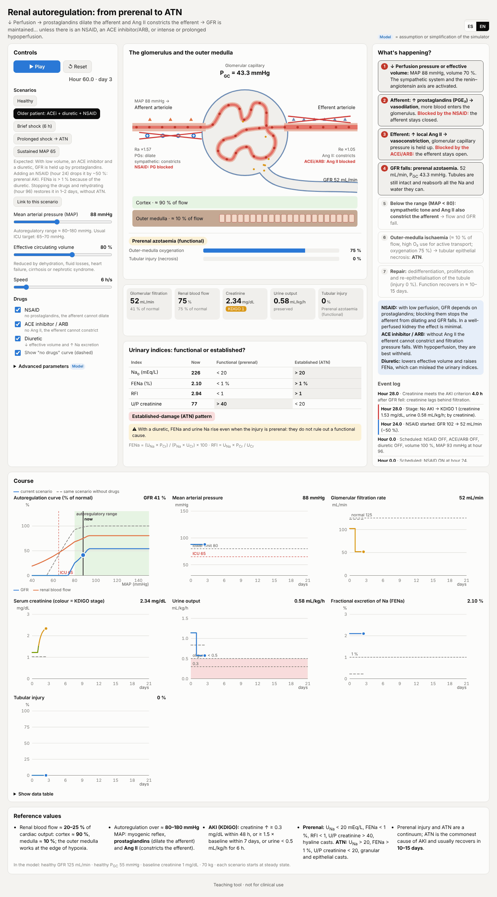

# Renal autoregulation: from prerenal to ATN — interactive teaching simulator

**Live demo:** https://ferasmed-dev.github.io/renal-autoregulation/ · English: [`?lang=en`](https://ferasmed-dev.github.io/renal-autoregulation/?lang=en)

An interactive model of how the kidney keeps its filtration rate stable when perfusion falls, how **NSAIDs** and **ACE inhibitors/ARBs** break that defence, and how prolonged hypoperfusion turns **prerenal azotaemia** into **acute tubular necrosis (ATN)**. It shows the creatinine and urine-output course with live **KDIGO AKI staging**, and the urinary indices that separate functional from established injury. The interface is in **Spanish and English** (ES/EN switch, top right).

> ⚠️ **Teaching tool, not for clinical use.** The numbers are chosen to show mechanisms and directions, not to predict any patient's course.



## Curriculum fit

For students and teachers at **any Spanish medical faculty**. The topic belongs to the common core every Grado en Medicina must cover (Orden ECI/332/2008):

- **Module I** (morfología, estructura y función): renal blood flow and its autoregulation.
- **Module III** (formación clínica humana): acute kidney injury: prerenal vs intrinsic, ATN, nephrotoxic drugs.
- **Module IV** (procedimientos diagnósticos y terapéuticos): urinary indices (FENa, renal failure index, U/P creatinine), KDIGO staging.

It is usually taught in **Fisiología, Fisiopatología, Farmacología, Patología médica / Nefrología** and **Medicina intensiva / Urgencias**. It is **MIR-relevant**: the NSAID + ACE inhibitor + diuretic combination ("triple whammy"), prerenal vs ATN indices and their exceptions, and KDIGO criteria are frequent exam topics. Topic metadata for catalogues is in [`curriculum.json`](curriculum.json).

## For teachers

Every scenario has a direct link that opens it and starts playing. Add `&lang=en` for English. The **"Link to this scenario"** button copies it.

| Scenario | Link |
|---|---|
| Healthy | `https://ferasmed-dev.github.io/renal-autoregulation/?preset=healthy` |
| Older patient: ACEi + diuretic + NSAID | `https://ferasmed-dev.github.io/renal-autoregulation/?preset=tripleWhammy` |
| Brief shock (6 h) | `https://ferasmed-dev.github.io/renal-autoregulation/?preset=briefShock` |
| Prolonged shock → ATN | `https://ferasmed-dev.github.io/renal-autoregulation/?preset=prolongedShock` |
| Sustained MAP 65 (usual ICU target) | `https://ferasmed-dev.github.io/renal-autoregulation/?preset=icuTarget65` |

Suggested uses: project the **triple-whammy** case and ask students to predict the GFR before pressing play. Use **prolonged shock** to show that GFR stays low after the blood pressure recovers, and that creatinine peaks days after the insult. With the diuretic on, show that FENa > 1 % does not rule out a prerenal cause.

## What it shows

1. **↓ Perfusion pressure or effective volume** activates the sympathetic system and the renin–angiotensin axis.
2. **Afferent arteriole:** prostaglandins (PGE₂) dilate it, together with the myogenic reflex. **NSAIDs** block this, and the afferent stays closed.
3. **Efferent arteriole:** local Ang II constricts it, holding glomerular capillary pressure up. **ACE inhibitors/ARBs** block this, and the efferent stays open.
4. Together these keep GFR stable across the **autoregulatory range (≈ 80–180 mmHg)**. If either defence is blocked during hypoperfusion, GFR falls: **prerenal azotaemia**, with intact tubules that avidly reabsorb Na and water.
5. **Below the range** (MAP < 80), sympathetic tone and Ang II also constrict the afferent, and flow and GFR fall. The usual ICU target of 65–70 mmHg lies below this range.
6. If hypoperfusion is intense or prolonged, the **outer medulla** becomes ischaemic. It gets ≈ 10 % of renal blood flow but has a high O₂ demand for active transport. The tubular epithelium necroses: **ATN**, through initiation → extension → maintenance → repair, with recovery in ≈ 10–15 days.

The app has:
- **A schematic** of the glomerulus. Afferent and efferent widths change; prostaglandin, sympathetic and Ang II markers appear, and drug blocks are crossed out. Blood and filtrate move with the flow. A cortex/outer-medulla strip shows medullary oxygenation and necrotic tubular cells.
- **The autoregulation curve.** GFR and renal blood flow (% of normal) against MAP are drawn live for the current volume and drugs, with the autoregulatory range, the ICU 65 mmHg line and the current point. A dashed "no drugs" curve is shown for comparison.
- **Time charts** over days for MAP, GFR (coloured by phase), serum creatinine (coloured by KDIGO stage), urine output (with oliguria thresholds), FENa and tubular injury. Each has a dashed "same scenario without drugs" counterfactual, hover crosshairs and a data table.
- **A urinary indices table** (U<sub>Na</sub>, FENa, renal failure index, U/P creatinine). It lists the classic cut-offs, highlights the side the patient falls on, gives a verdict, and warns when a diuretic makes FENa misleading.
- **A "What's happening?" panel** that lights up each step of the chain as it happens, with clinical notes (stop NSAIDs/ACEi in hypoperfusion; supportive ATN treatment; dialysis indications). An event log records stage changes, oliguria, phase changes, and **how many hours creatinine lags behind the fall in GFR**.

## The model (`src/model.js`)

Pure functions, no DOM. Units: mmHg, mL/min, hours, mg/dL, mL/kg/h.

**1. Neurohormonal activation** from low pressure and low effective volume (a diuretic removes 10 % of effective volume):

```
H = max(0, (93 − MAP)/13) + max(0, (1 − volume_eff)/0.3)
```

**2. Vasoactive signals** (each blockable):

```
Ang II index   A    = 1 + 0.5·H              → after ACEi/ARB:  1 + (A − 1)(1 − 0.8)
Prostaglandins PG   = 0.38·H                 → after NSAID:     PG·(1 − 0.9)
Sympathetic    S    = 0.6·(H + 0.2·b²),  b = max(0, 80 − MAP)/10
Myogenic       myo  = (max(80, MAP)/93)^1.86          (MAP ≤ 93)
```

**3. Resistances and glomerular pressure** (series resistors; healthy Ra = 1, Re₀ = 55/38):

```
Ra   = myo · (1 + S) / (1 + PG_eff)
Re   = Re₀ · (1 + 0.35·(A_eff − 1))
P_GC = MAP · Re / (Ra + Re)             RBF_rel = (MAP/(Ra + Re)) / (93/(1 + Re₀))
```

Above 93 mmHg (up to 180) the myogenic reflex sets Ra so that P_GC and flow stay at their 93 mmHg values, which makes the curve flat across the range.

**4. Filtration** (Starling with fixed P_BS = 10 and mean π_GC = 25 mmHg; Kf calibrated to 125 mL/min at P_GC = 55) and **tubular injury D** (0–1):

```
GFR = Kf · max(0, P_GC − 10 − 25) · (1 − D)^2
```

The `(1 − D)^2` factor stands for back-leak, tubular obstruction and afferent constriction by tubuloglomerular feedback in ATN.

**5. Ischaemic injury and repair** (explicit Euler, Δt = 0.25 h):

```
if RBF_rel < 0.6:  dD/dt = 0.06 · (0.6 − RBF_rel)/0.6 · (1 − D)
else:              dD/dt = −D / 96 h          (≈ 95 % repaired in 12 days)
```

**6. Creatinine kinetics** (fixed production; volume of distribution = total body water, 0.6 × weight). Each scenario starts at steady state for its initial GFR:

```
d[Cr]/dt = (G − GFR·[Cr]) / Vd,    G = 125 mL/min × baseline Cr
```

**7. Urine and indices.** Fractional excretions fall with neurohormonal avidity, rise with tubular injury and with diuretics:

```
FE_water (%) = 1.0·(1 − 0.2·min(1, H)) + 6·D + 0.5·[diuretic]
FENa (%)     = 0.6·(1 − 0.9·min(1, H/1.5)) + 4·D + 2·[diuretic]
UO = GFR·FE_water   ·   U_Na = P_Na·FENa/FE_water   ·   U/P Cr = 100/FE_water   ·   RFI = U_Na/(U/P Cr)
```

The indices are classified by majority vote against U<sub>Na</sub> 20 mEq/L, FENa 1 %, RFI 1 and U/P creatinine 40 / 20.

**8. KDIGO AKI stage**, computed live from the creatinine and urine histories:
- **Creatinine:** a rise of ≥ 0.3 mg/dL within 48 h, or a ratio to the lowest value in the previous 7 days of ≥ 1.5 / 2 / 3; a value ≥ 4.0 mg/dL with an acute rise also counts as stage 3.
- **Urine output** (mean over the window): < 0.5 mL/kg/h for 6 h → stage 1, for 12 h → stage 2; < 0.3 for 24 h or anuria for 12 h → stage 3.

### Parameters

| Parameter | Value | Basis |
|---|---|---|
| Healthy GFR, P_GC, P_BS, mean π_GC | 125 mL/min, 55, 10, 25 mmHg | Physiology (teaching values) |
| Autoregulatory range | 80–180 mmHg | Physiology (Guyton & Hall) |
| Renal blood flow split | cortex ≈ 90 %, medulla ≈ 10 % of 20–25 % of cardiac output | Physiology (displayed) |
| ICU MAP target | 65–70 mmHg | Surviving Sepsis Campaign (displayed) |
| Prerenal vs ATN cut-offs | U<sub>Na</sub> 20, FENa 1 %, RFI 1, U/P Cr 40/20 | Standard nephrology teaching |
| KDIGO AKI criteria | as above | KDIGO 2012 AKI guideline |
| Recovery of ATN | ≈ 10–15 days | Standard teaching |
| Activation gains, PG/Ang II/sympathetic strengths, block fractions (ACEi 80 %, NSAID 90 %), diuretic volume 10 % | see `DEFAULTS` | Tuning assumptions (calibrated so NSAID + ACEi in hypovolaemia cut GFR by ≈ 60 %) |
| Ischaemia threshold, injury rate, repair constant, GFR–injury exponent | 0.6, 0.06/h, 96 h, 2 | Tuning assumptions |
| FE water / FENa model | as above | Tuning assumptions reproducing the classic index patterns |
| Weight, baseline creatinine | 70 kg, 1.0 mg/dL | Adjustable defaults |

### Known simplifications

- One representative nephron population; cortex and medulla are not modelled as separate circulations, only the medullary ischaemia threshold.
- No tubular secretion of creatinine (≈ 15 %, more in kidney failure), so real creatinine rises slightly less than modelled when GFR falls; drugs that block secretion (trimethoprim, cimetidine, spironolactone) are not modelled.
- π_GC and Kf are fixed. Filtration fraction effects and mesangial contraction are not modelled.
- ACEi/ARB and NSAIDs act only on the renal arterioles here; they don't change systemic blood pressure. Move the MAP slider yourself.
- Potassium, acid–base status, toxic ATN (aminoglycosides, contrast, pigments) and post-renal obstruction are not modelled.
- Urine output in KDIGO staging uses the mean over each window rather than every hourly value.

### Scenarios and what they should do

| Scenario | Settings | Expected (checked by `tests/model.test.js`) |
|---|---|---|
| Healthy | MAP 93, normal volume | GFR 125 mL/min, creatinine 1.0, no AKI for 21 days |
| Older patient: ACEi + diuretic + NSAID | MAP 88, volume 80 %, ACEi + diuretic; NSAID from hour 24; all stopped and volume restored at hour 96 | GFR 102 → 52 mL/min when the NSAID is added; creatinine 1.22 → 2.42 (KDIGO 1); FENa > 1 % because of the diuretic; **no tubular injury**; back to 125 within ~1–2 days of stopping |
| Brief shock | MAP 55 for 6 h | GFR ≈ 9 mL/min with prerenal indices; injury peaks at 12 %; creatinine ≈ 2.0 (KDIGO 1); near baseline within a week |
| Prolonged shock → ATN | MAP 55 for 36 h, then 65 for 24 h, then 85 | Injury up to 59 %, oliguria, creatinine peaks ≈ 8.5 mg/dL on day 3 (KDIGO 3), established indices; GFR only 22 mL/min at hour 75 although MAP is back to 85 (maintenance); injury < 5 % and GFR ≈ 108 by day 14 |
| Sustained MAP 65 | MAP 65 for 72 h | GFR ≈ 46 mL/min at once (functional indices); slow tubular injury up to ≈ 25 %, creatinine ≈ 4.1 (KDIGO 3); recovers after MAP is raised |

Steady-state curve (normal volume, no drugs): GFR 111 mL/min at MAP 80, 69 at 70, 46 at 65, 23 at 60, ≈ 0 at 50; 125 from 93 to 180 mmHg. With MAP 85 and 75 % volume: 121 mL/min; NSAID 72; ACEi 99; both 49.

## Repository layout

```
index.html           page markup (text filled in from i18n.js)
src/model.js         physiology — pure functions, KDIGO staging, scenarios
src/i18n.js          Spanish and English strings
src/ui.js            DOM, animation loop, explanations, language switch, scenario links
src/charts.js        tiny dependency-free SVG charts
src/styles.css       styles (light/dark)
tests/model.test.js  unit tests (Node's built-in test runner)
curriculum.json      topic metadata (curriculum module, subjects, keywords)
docs/screenshot.png  screenshot used above
.github/workflows/   runs the tests on every push
```

No build step, no dependencies, no CDN: everything is plain ES modules.

## Run locally

```bash
python3 -m http.server 8000      # then open http://localhost:8000
node --test                      # run the tests (Node ≥ 18), or: npm test
```

## Deploy to GitHub Pages

1. Create an empty **public** repository named `renal-autoregulation` (no README or licence).
2. Upload the **contents** of this folder (not the folder itself) and commit to `main`, or from a terminal:
   ```bash
   git init -b main && git add . && git commit -m "Renal autoregulation simulator"
   git remote add origin https://github.com/ferasmed-dev/renal-autoregulation.git
   git push -u origin main
   ```
3. **Settings → Pages → Deploy from a branch → `main` / `(root)` → Save.** The site is live at `https://ferasmed-dev.github.io/renal-autoregulation/` after a minute or two.

## References

- KDIGO Clinical Practice Guideline for Acute Kidney Injury. *Kidney Int Suppl* 2012;2:1–138.
- Hall JE, Hall ME. *Guyton and Hall Textbook of Medical Physiology*: renal blood flow, glomerular filtration and autoregulation.
- Abuelo JG. Normotensive ischemic acute renal failure. *N Engl J Med* 2007;357:797–805 (impaired autoregulation, NSAIDs and ACE inhibitors).
- Brezis M, Rosen S. Hypoxia of the renal medulla — its implications for disease. *N Engl J Med* 1995;332:647–655.
- Lapi F et al. Concurrent use of diuretics, ACE inhibitors and ARBs with NSAIDs and risk of acute kidney injury. *BMJ* 2013;346:e8525 ("triple whammy").
- Evans L et al. Surviving Sepsis Campaign: international guidelines 2021. *Crit Care Med* 2021;49:e1063–e1143 (MAP target 65 mmHg).
- Espinel CH. The FENa test: use in the differential diagnosis of acute renal failure. *JAMA* 1976;236:579–581.

## Licence

MIT — see [LICENSE](LICENSE).
